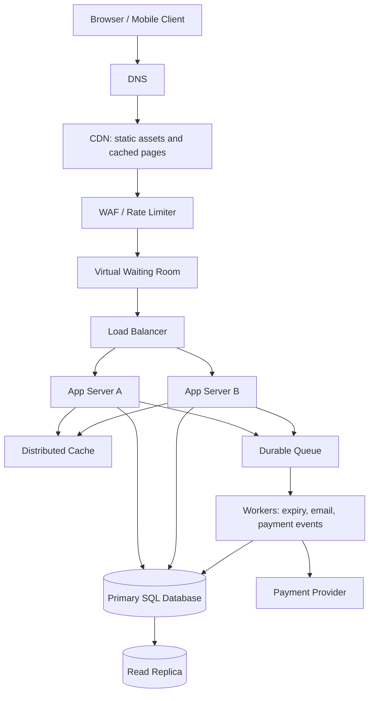

# TicketHub — System Design

## 1. Requirements

### Functional requirements
- Browse, search, and filter events by artist, venue, date, and location.
- View event details, prices, seat maps, and seat availability.
- Authenticated users can place time-limited holds on available seats, pay for an order, and view/download tickets.
- Expired holds are released; payment failures and refunds are handled safely.
- Administrators can create events, configure seats/prices, and monitor sales.

### Non-functional requirements
- **Speed:** Event listings should normally load in under 300 ms at p95; seat-map/API responses under 500 ms at p95, excluding payment-provider latency.
- **Correctness:** A seat must never be confirmed in two active orders. Inventory changes and order transitions must be atomic and auditable.
- **Fairness:** Use a server-managed virtual waiting room for high-demand sales, queue positions, admission tokens, and rate limits. Refreshing repeatedly must not improve a user's position.
- **Availability:** Target 99.9% monthly availability for browsing and 99.95% for checkout where practical. Fail safely rather than oversell when dependencies are unhealthy.
- **Security/privacy:** Authenticate account actions, authorize order access, encrypt traffic, store no raw card details, and use a PCI-compliant payment provider.
- **Scalability/observability:** Scale stateless app instances horizontally; monitor latency, queue depth, hold expiry, payment failures, and inventory conflicts.

## 2. Traffic and capacity estimates

These are planning estimates, not measured production values. Assume a 30-day month, normal page views spread across 24 hours for average-rate calculations, and 3–5 API calls per page view. Actual peak traffic will be higher than daily averages.

### Normal day
- Registered users: **2,000,000**.
- Daily visitors: **50,000**.
- Page views: 50,000 × 10 = **500,000/day**.
- Average page-view rate: 500,000 ÷ 86,400 ≈ **5.8/second**.
- Tickets sold: **5,000/day**, or 5,000 ÷ 86,400 ≈ **0.058/second** averaged across the day.
- At 3–5 API calls per page view, average API traffic is about **17–29 requests/second**. A 10× busy-hour factor suggests **170–290 requests/second** during ordinary peaks.

### Popular concert sale
- Buyers attempting to purchase: **200,000 in 10 minutes**.
- Arrival rate: 200,000 ÷ 600 = **about 333 people/second**.
- Seats available: **20,000**. Demand is 10 people per seat; at most 10% of these people can get one seat if each wants one.
- At 3–6 API calls per buyer, raw demand could reach **1,000–2,000 requests/second**, excluding retries and seat-map refresh storms.
- Arrival rate is about **57× the normal all-day average page-view rate** (333 ÷ 5.8), and estimated API demand is around **3.4–11.8× the normal busy-hour API estimate**. A refresh storm could push it much higher.

### Capacity approach
Use a virtual waiting room to meter admission to checkout, starting with perhaps 300–500 admitted users/second and adjusting based on database latency and payment-provider capacity. Serve static assets and event descriptions from a CDN/cache. Cached availability summaries may support browsing, but the database transaction makes the authoritative seat decision. Load-test at least 2,000 requests/second plus retries and verify graceful overload behavior.

## 3. API design

Base path: `/api/v1`. Use JSON over HTTPS. Authenticated routes require a bearer token. Mutating checkout calls accept an `Idempotency-Key` so retries do not create duplicate orders or charges.

| Method and path | Purpose | Success status |
|---|---|---:|
| `GET /events?query=&date=&venue=` | Search and browse events with pagination | `200 OK` |
| `GET /events/{eventId}` | Get event details, venue, and sale information | `200 OK` |
| `GET /events/{eventId}/seats` | Get seat map and availability snapshot | `200 OK` |
| `POST /holds` | Atomically hold one or more seats for a short period | `201 Created` |
| `DELETE /holds/{holdId}` | Release the caller's active hold | `204 No Content` |
| `POST /orders` | Create a pending order from a valid hold | `201 Created` |
| `POST /orders/{orderId}/payment` | Start payment through the provider | `202 Accepted` |
| `GET /me/tickets` | List tickets owned by the signed-in user | `200 OK` |
| `GET /orders/{orderId}` | View an order's status | `200 OK` |

### Browse-events example
`GET /api/v1/events?date=2026-11-12&page=1&pageSize=20`

```json
{
  "data": [
    {
      "id": "evt_482",
      "name": "The Example Band",
      "venue": "Central Arena",
      "startsAt": "2026-11-12T19:30:00Z",
      "currency": "USD",
      "startingPrice": 45.00
    }
  ],
  "page": 1,
  "pageSize": 20,
  "total": 1
}
```

### Hold-seats example
`POST /api/v1/holds`

```json
{
  "eventId": "evt_482",
  "seatIds": ["seat_A12", "seat_A13"]
}
```

Success (`201 Created`):

```json
{
  "id": "hold_903",
  "status": "active",
  "expiresAt": "2026-11-01T10:05:00Z",
  "seatIds": ["seat_A12", "seat_A13"]
}
```

If any requested seat is unavailable, reject the whole request with `409 Conflict`; do not create a partial hold.

### Create-order example
`POST /api/v1/orders` with `Idempotency-Key: 7b2d...`

```json
{
  "holdId": "hold_903",
  "billingCountry": "KE"
}
```

Success (`201 Created`):

```json
{
  "id": "ord_1207",
  "status": "pending_payment",
  "amount": 90.00,
  "currency": "USD",
  "paymentUrl": "https://payments.example/checkout/session_abc"
}
```

### Error responses
Example error body:

```json
{
  "error": {
    "code": "SEAT_UNAVAILABLE",
    "message": "One or more selected seats are no longer available.",
    "requestId": "req_01J..."
  }
}
```

- `400 Bad Request` — malformed input or invalid seat list.
- `401 Unauthorized` — missing or invalid authentication.
- `403 Forbidden` — user is not allowed to access the resource.
- `404 Not Found` — event, hold, order, or ticket does not exist or is not visible.
- `409 Conflict` — seat unavailable, hold expired, or conflicting order state.
- `422 Unprocessable Entity` — valid JSON violates a business rule.
- `429 Too Many Requests` — rate limit or waiting-room limit reached.
- `500 Internal Server Error` — unexpected server error.
- `503 Service Unavailable` — temporary overload or dependency outage.

## 4. Data model

Use a relational database such as PostgreSQL as the source of truth for inventory and orders. A production system would also add venues, payment records, ticket delivery records, audit logs, and idempotency records.

```sql
CREATE TABLE users (
    id BIGSERIAL PRIMARY KEY,
    email VARCHAR(320) NOT NULL UNIQUE,
    password_hash TEXT NOT NULL,
    display_name VARCHAR(120) NOT NULL,
    created_at TIMESTAMPTZ NOT NULL DEFAULT now()
);

CREATE TABLE events (
    id BIGSERIAL PRIMARY KEY,
    name VARCHAR(200) NOT NULL,
    venue_name VARCHAR(200) NOT NULL,
    starts_at TIMESTAMPTZ NOT NULL,
    sales_open_at TIMESTAMPTZ,
    status VARCHAR(20) NOT NULL DEFAULT 'draft',
    created_at TIMESTAMPTZ NOT NULL DEFAULT now(),
    CHECK (status IN ('draft', 'on_sale', 'sold_out', 'cancelled'))
);

CREATE TABLE orders (
    id BIGSERIAL PRIMARY KEY,
    user_id BIGINT NOT NULL REFERENCES users(id),
    status VARCHAR(30) NOT NULL DEFAULT 'pending_payment',
    total_cents BIGINT NOT NULL CHECK (total_cents >= 0),
    currency CHAR(3) NOT NULL,
    idempotency_key VARCHAR(200) NOT NULL,
    created_at TIMESTAMPTZ NOT NULL DEFAULT now(),
    updated_at TIMESTAMPTZ NOT NULL DEFAULT now(),
    UNIQUE (user_id, idempotency_key),
    CHECK (status IN ('pending_payment', 'paid', 'failed', 'cancelled', 'refunded'))
);

CREATE TABLE seats (
    id BIGSERIAL PRIMARY KEY,
    event_id BIGINT NOT NULL REFERENCES events(id),
    section VARCHAR(60) NOT NULL,
    row_label VARCHAR(20) NOT NULL,
    seat_number VARCHAR(20) NOT NULL,
    price_cents INTEGER NOT NULL CHECK (price_cents >= 0),
    currency CHAR(3) NOT NULL,
    status VARCHAR(20) NOT NULL DEFAULT 'available',
    hold_id UUID,
    hold_expires_at TIMESTAMPTZ,
    order_id BIGINT REFERENCES orders(id),
    UNIQUE (event_id, section, row_label, seat_number),
    CHECK (status IN ('available', 'held', 'sold'))
);

CREATE INDEX events_sales_lookup_idx ON events (status, starts_at);
CREATE INDEX seats_availability_idx ON seats (event_id, status, section, row_label, seat_number);
CREATE INDEX orders_user_recent_idx ON orders (user_id, created_at DESC);
```

### Relationships and preventing double-booking
- **Users → orders:** one-to-many; one user can place many orders, and each order belongs to one user.
- **Events → seats:** one-to-many; an event has many individually identifiable seats.
- **Orders → seats:** one order may contain multiple seats; a seat may belong to at most one active/successful order. A production schema can represent this explicitly with an `order_items` table whose `seat_id` is unique, plus a separate `seat_holds` table.

The database—not a cached seat map—is authoritative. A `POST /holds` transaction locks the requested seat rows using `SELECT ... FOR UPDATE`, verifies that every seat is available or has an expired hold, and updates all seats with one hold ID and expiry. If any seat conflicts, roll back the whole transaction. Converting a hold to an order locks the same rows and verifies that the hold is still active. A unique constraint on `order_items.seat_id` (or an equivalent unique active allocation constraint) is the final guard against duplicate allocation. Payment callbacks are idempotent, and seats become sold only after verified payment success. A worker releases expired holds, but the transaction checks expiry itself, so correctness does not depend on the worker running on time.

### Example SQL queries

```sql
-- 1. Upcoming events on sale
SELECT id, name, venue_name, starts_at
FROM events
WHERE status = 'on_sale' AND starts_at > now()
ORDER BY starts_at
LIMIT 50;

-- 2. A user's recent orders
SELECT id, status, total_cents, currency, created_at
FROM orders
WHERE user_id = 42
ORDER BY created_at DESC
LIMIT 20;

-- 3. JOIN: paid seats for an event
SELECT e.name AS event_name, s.section, s.row_label, s.seat_number,
       o.id AS order_id, o.user_id
FROM seats s
JOIN events e ON e.id = s.event_id
JOIN orders o ON o.id = s.order_id
WHERE e.id = 482 AND o.status = 'paid'
ORDER BY s.section, s.row_label, s.seat_number;
```

The availability index speeds up frequent seat lookups by event and status; the orders index speeds up a user's order history. SQL fits because seat allocation and order/payment transitions need transactions, constraints, and joins. A NoSQL store could hold flexible event metadata, but should not be the inventory source of truth unless it offers equivalent transactional guarantees.

## 5. Architecture



### Component responsibilities
- **Browser/mobile client:** Provides event discovery, seat selection, checkout, and ticket access.
- **DNS:** Resolves the service hostname and routes users to the service entry point.
- **CDN:** Serves static assets and cacheable event content close to users, reducing latency and origin traffic.
- **WAF/rate limiter:** Filters common attacks and throttles abusive clients before they exhaust the app.
- **Virtual waiting room:** Admits users in queue order at a controlled rate, smoothing the onsale spike and improving fairness.
- **Load balancer:** Distributes requests across healthy app instances and removes unhealthy instances.
- **App servers A and B:** Run the stateless API and can scale horizontally; either can fail without taking down the whole API.
- **Distributed cache:** Holds event metadata and non-authoritative availability summaries so frequent reads do not all hit the database.
- **Primary SQL database:** Owns seat inventory, holds, orders, and transactional constraints.
- **Read replica:** Offloads browse/reporting queries; checkout decisions use the primary to avoid stale-read overselling.
- **Durable queue:** Buffers asynchronous tasks and smooths bursts instead of running all work in the request path.
- **Workers:** Handle hold expiry, ticket delivery, payment webhooks, retries, and reconciliation.
- **Payment provider:** Processes card details without TicketHub storing raw card data.

### GET `/api/v1/events/{eventId}/seats` flow
1. Client resolves the hostname through DNS and sends an HTTPS request.
2. CDN/WAF serves cacheable assets and applies security/rate limits; dynamic API traffic passes through.
3. The load balancer routes the request to a healthy app server.
4. The app checks the cache for event and seat-map summary; on a miss, it reads display data from the database or read replica.
5. The app returns a seat map and availability snapshot. The response is indicative; the later hold transaction makes the authoritative decision.

### POST `/api/v1/holds` and checkout flow
1. The waiting room admits a user and issues a short-lived signed token.
2. The client submits seat IDs and an idempotency key to the hold endpoint.
3. The app begins a database transaction, locks seat rows, checks availability, and atomically creates the hold and expiry. Any conflict rolls back the entire request and returns `409 Conflict`.
4. The client creates an order from the valid hold; the server checks hold ownership and expiry and records the order idempotently.
5. Payment starts with the provider. A signed webhook is verified, then an idempotent transaction marks the order paid and seats sold.
6. A worker sends tickets/confirmation. Failed payment or an expired hold follows a defined state transition and safely releases inventory.

## 6. Trade-offs and resilience

1. **Strong consistency vs. read speed:** Primary-database transactions add latency and constrain write throughput, but prevent double-booking. Cache and replicas serve browse traffic only; checkout validates on the primary.
2. **Fairness vs. instant access:** A waiting room makes users wait even if seats appear available, but protects service capacity and prevents refresh races. Queue order, tokens, and anti-bot rules should be observable and consistent.
3. **Short holds vs. conversion time:** Short holds turn inventory over quickly but may disadvantage users with slow payment flows. Show a clear countdown and use a bounded extension policy.
4. **Availability vs. safe checkout:** If database or payment status is uncertain, checkout may pause rather than risk duplicate sales. Multi-zone database failover, backups, health checks, replicated queues, and recovery drills reduce outages.
5. **Cached availability vs. accuracy:** Cached seat maps are fast but can be stale. Clearly treat them as snapshots and revalidate atomically when a hold is requested.

### Avoiding single points of failure
Run app instances in at least two availability zones behind health-checked load balancing; use a replicated cache and durable queue; deploy the primary database with a multi-zone standby and tested failover; keep the read replica in a separate failure domain; and use managed, redundant DNS/CDN/WAF services. Monitor failover and practise recovery. Payment-provider outages should result in explicit pending states, idempotent retries, and reconciliation—not an assumption that a timeout means payment failed.
